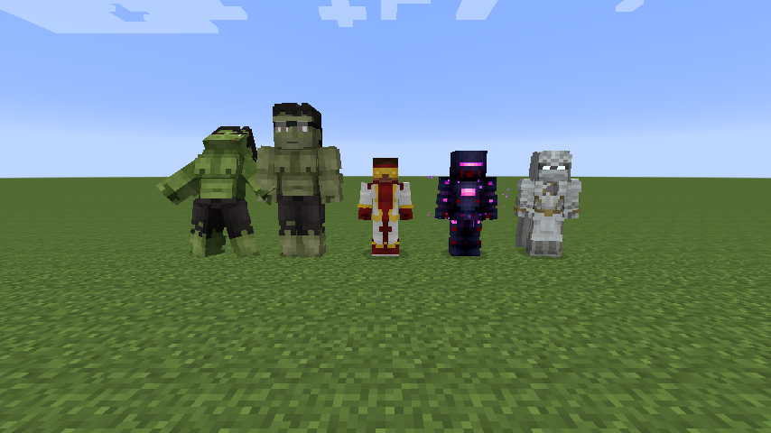
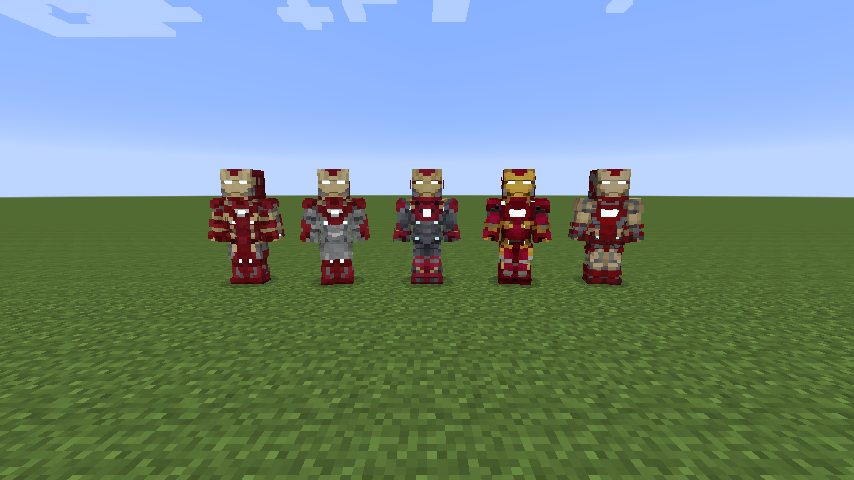
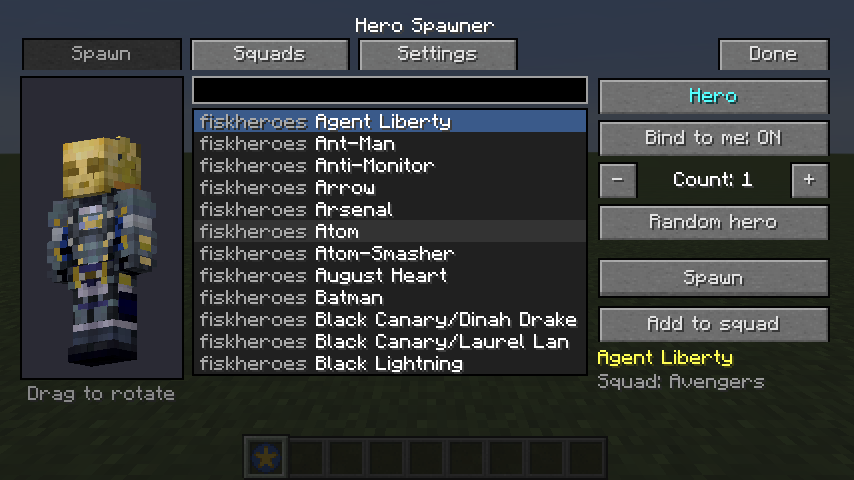
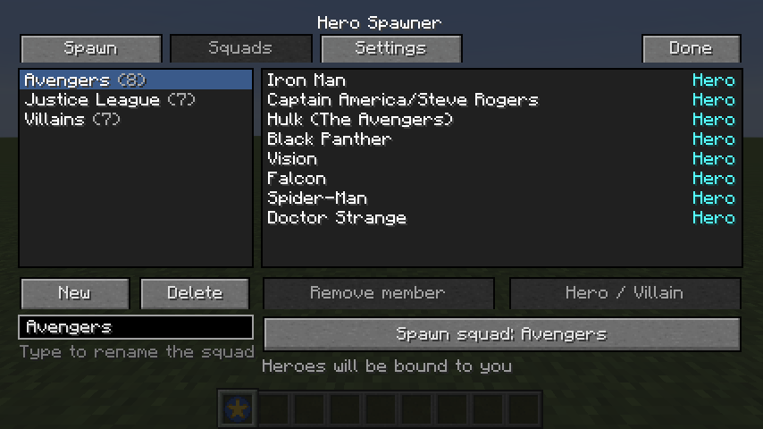
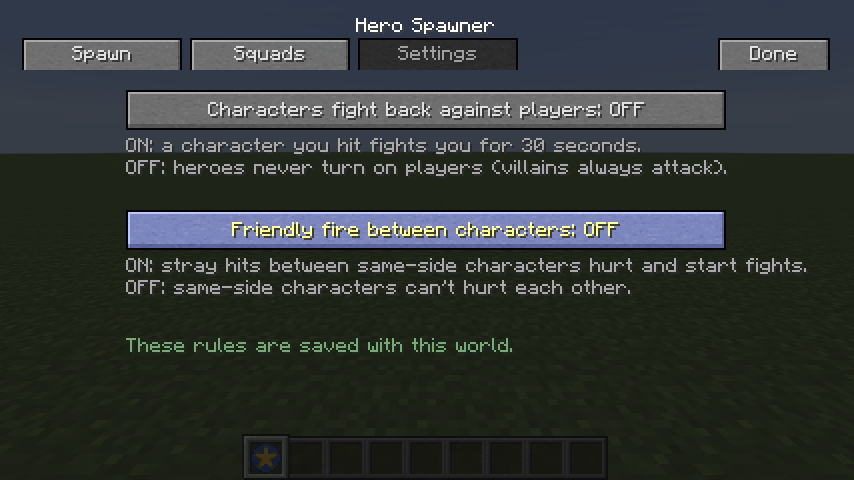
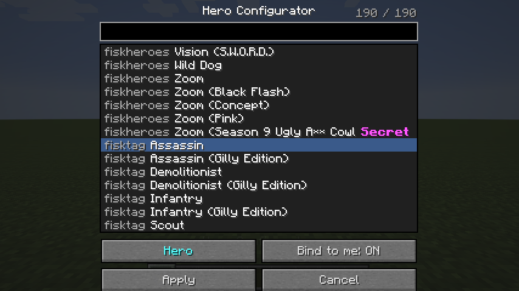
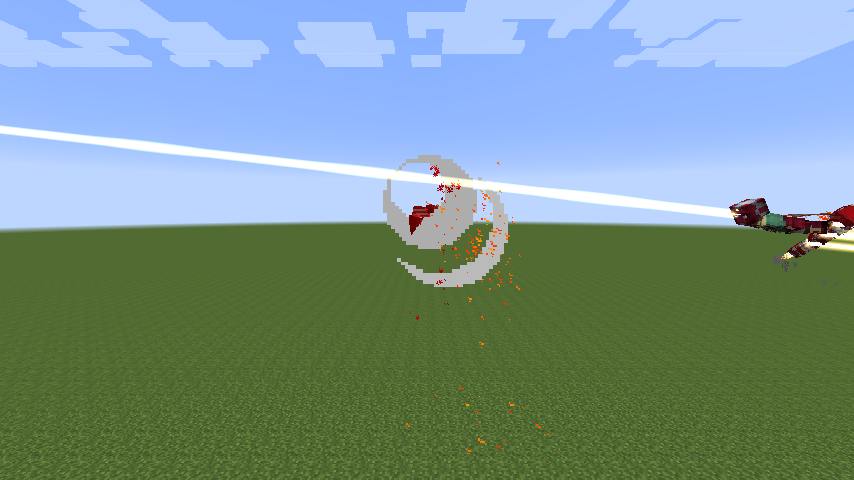
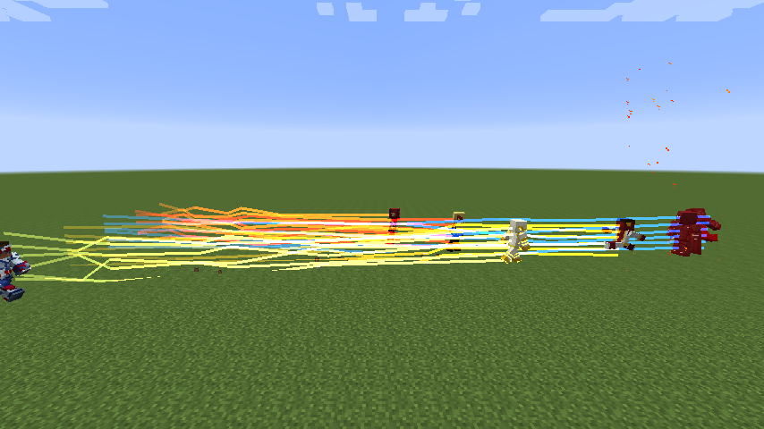

# Fisk Companions

A Minecraft **1.7.10** add-on for [Fisk's Superheroes](https://www.curseforge.com/minecraft/mc-mods/fiskheroes).
It adds superhero and supervillain characters that walk around, fly and fight on their own. Each one wears **any** suit
from Fisk's Heroes or from any heropack you have installed, and uses that suit's powers.

- **Hero**: your partner. It protects you, follows you and fights alongside you.
- **Villain**: an enemy. It attacks players, villagers, golems and animals.
- Heroes and villains fight each other on sight.




---

## Beginner's guide

### 1. What you need
| Thing | Version |
|---|---|
| Minecraft | 1.7.10 |
| Forge | 10.13.4.1614 |
| Fisk's Superheroes | 2.4.0 ([Modrinth](https://modrinth.com/mod/fiskheroes) / [CurseForge](https://www.curseforge.com/minecraft/mc-mods/fiskheroes)) |
| Java | 8 (Prism Launcher sets this up for you) |
| Heropacks | optional, any number (e.g. SecretHeroes) |

### 2. Install it (Prism Launcher)
1. In Prism Launcher, select your **1.7.10 Forge** instance and click **Edit**.
2. Open the **Mods** page and click **Add file**. Pick `FiskHeroes-1.7.10-2.4.0.jar`, if you don't have it yet, and
   `fiskcompanions-v0.0.2.jar`.
3. *(Optional)* Heropacks are `.zip` files. Don't unzip them. In the same Edit window click **Open folder**
   (the `minecraft` folder) and drop the zip into the **`fiskheroes`** folder there. You can also add it in game
   under **Options → HeroPacks**.
4. Start the game. On the main menu, **Mods** should list **Fisk Companions**.

Other launchers work the same way: put both jars in `mods/` and heropack zips in `fiskheroes/`.

### 3. Get the Hero Configurator
The Hero Configurator (a gold star icon) is the only tool you need. Right-click with it to open the Hero Spawner menu,
or right-click a character with it to change that character.
- **Creative mode:** find it in the **Tools** tab.
- **Survival mode:** there's no crafting recipe yet. Use a command (cheats must be on):
  ```
  /give @p fiskcompanions:hero_configurator
  ```

### 4. Open the Hero Spawner
Hold the Configurator and **right-click** (into the air or at the ground). The **Hero Spawner** menu opens. It has three
tabs at the top: **Spawn**, **Squads** and **Settings**. **Done** closes it.

**Remove all** (top bar) removes your characters from the world. Click it, then click again within 3 seconds to confirm.
In singleplayer or Creative it removes every character; on a server it removes yours and unowned ones.

#### Spawn tab: one character, or several of the same


1. **Search box**: type part of a name, for example `hulk`, `iron` or `flash`.
2. **List**: scroll with the mouse wheel and **click a suit**. The grey word in front is the heropack it comes from.
3. **Preview** (left): the selected suit on a 3D figure, already transformed (Hulk green and big, Iron Man nanites
   on). **Hold the left mouse button on it and drag** to turn it.
4. **Hero / Villain**: which side the character is on.
5. **Bind to me**: Heroes you spawn belong to you (they follow and protect you).
6. **- Count +**: how many to spawn at once (1-10).
7. **Random hero**: picks a random suit.
8. **Spawn**: the characters appear in front of you.
9. **< Squad >**: the arrows choose which squad **Add to squad** puts the selected suit (with its side) into.
   If that character is already in the squad, a warning appears: **Add** (add it again), **Remove** (take the existing
   one out) or **x** (do nothing).

#### Squads tab: spawn a whole team with one button


- Three squads are ready to use, all made of Fisk's Superheroes characters (no heropack needed):
  - **Avengers**: Iron Man, Captain America, Ant-Man, Black Panther, Vision, Falcon, Spider-Man, Doctor Strange
  - **Justice League**: Batman, Shazam, Martian Manhunter, The Flash, Black Canary, Green Arrow, The Atom
  - **Villains**: Reverse-Flash, Zoom, Deathstroke, Captain Cold, Doctor Octopus, Crossbones, Savitar
- Click a squad on the left, then **Spawn squad** spawns everyone in it at once.
- **New** makes an empty squad; **Delete** removes the selected one. Type in the box under the list to **rename** it.
- Click a member on the right, then **Remove member** or **Hero / Villain** to switch its side.
- To add members, go to the **Spawn** tab, pick a suit and side, and press **Add to squad**.
- Squads are saved on your computer (`config/fiskcompanions-squads.json`), so they work in every world. Members from
  a heropack you don't have installed are shown greyed out and skipped.

#### Settings tab: friendly fire


| Setting | OFF (default) | ON |
|---|---|---|
| **Characters fight back against players** | You can hit your heroes, but they never turn on you | A character you hit fights you for 30 seconds |
| **Friendly fire between characters** | Stray hits between characters on the same side (a missed web, a blast) do nothing | They hurt each other and fight back |

The settings are saved with the world. In singleplayer you can always change them; on a server only operators can.

### 5. Change a character that's already there
Hold the Configurator and **right-click the character**. A smaller window opens where you pick a new suit, switch
Hero/Villain and bind it to you, then press **Apply**. Only the owner (or a player in Creative) can change a character.



### 6. What the characters do
**A Hero (your partner):**
| Situation | What it does |
|---|---|
| You are **not** wearing a suit | Stays close to you (bodyguard), attacks monsters within about 12 blocks of you and anything that hurts you |
| You **are** wearing a full suit | Follows you at a short distance and attacks whatever you attack. When you drop below 60% health it gives you Regeneration (at most once every 20 seconds) |
| You walk far away | Flies to you if its suit can fly, otherwise teleports to you when it's more than 24 blocks away |
| Always | Never attacks players, and fights every Villain it sees |

**A Villain (your enemy):**
- Attacks every player (suited or not), plus villagers, iron/snow golems and animals.
- Fights Heroes first when one is nearby.
- Does nothing on **Peaceful** difficulty. Players in Creative are never attacked.

**Flying.** Suits that can fly take off when their target or owner is far away or up in the air, and fly with Fisk's
own flight animations: leaning forward when moving, lying flat and speeding when far away (boost), and hovering when
close. They land again once they're near their target on the ground.

Each suit flies at **its own speed**, taken from the suit's flight settings. The Atom is slow, Iron Man and Martian
Manhunter are fast, and the Anti-Monitor is very fast. Flying far away is faster than flying close (like sprinting).



**Speedsters.** Characters with super speed (The Flash, Reverse-Flash, Zoom, Impulse, Godspeed, any heropack speedster)
run at their suit's top speed level when their target or owner is far away, leaving lightning trails in the suit's
colours. They slow down as they get close and fight at normal speed. Faster suits have more speed levels: in a 28-block
race Zoom arrives in about half a second, while a normal hero needs more than two seconds.



**Weapons and gadgets.** Characters use the gear that comes with their suit:
| Character | What they use |
|---|---|
| Spider-Man (every version) | Web shooters: sticky, impact, ricochet and rapid webs |
| Batman | Batarangs, smoke pellets, freeze grenades |
| Deadpool | Desert Eagles at range (dual), katana up close |
| Captain America | His shield as a melee weapon |
| Any heropack suit | Its own gadgets and weapons, if it defines them |

They throw or shoot at targets a few blocks away and switch to melee weapons up close. Characters never run out of ammo.

**Powers.** Characters use their suit's real powers: flight, blasts and beams, fireballs, ice, heat vision,
shields, blades, ground smash, Hulk's Thunderclap, and more. Suits that transform first (Hulk, Moon Knight, Iron Man
Mk50 nanites) transform by themselves. Strength, healing factor and resistances work just like on a player.

### 7. Give orders
| What | How |
|---|---|
| Stay here / follow me | **Sneak + right-click** your Hero with an **empty hand**. A chat message confirms it |
| Change suit or side | Right-click the character with the Configurator |
| Spawn characters or a squad | Right-click anywhere else with the Configurator |
| Get rid of one | Defeat it. Characters never despawn on their own, and their suits are never dropped |

### 8. Quick troubleshooting
| Problem | Fix |
|---|---|
| "No Fisk's Heroes suits are loaded" | Fisk's Heroes isn't installed, or the game needs a restart |
| A heropack's heroes aren't in the list | The zip must be in the instance's `fiskheroes` folder (not `mods`), not unzipped; restart the game |
| "Only this character's owner can reconfigure it" | Someone else owns it. Ask them, or use Creative |
| My Hero doesn't follow | It's set to stay. Sneak + right-click it with an empty hand |
| A Villain ignores me | You're in Creative, or the difficulty is Peaceful |
| My heroes keep hurting each other | Turn **Friendly fire between characters** OFF on the Settings tab |
| The Settings buttons are grey | On a server only operators can change them |

### Multiplayer
Install the same jars and heropacks on the **server and on every player's game**. Server play has not been tested yet.

---

## Known limitations
- Some powers aren't used yet: telekinesis, tentacles, teleport, spells, earthquake, lightning, web-swinging/web-zip,
  Green Arrow's bow (archery) and shield throwing.
- Transformations a heropack triggers **only** with its own scripted key (not Fisk's standard transformation) can't run
  on a mob. The character then stays in its untransformed look.
- Ground smash damages and knocks back but doesn't break blocks.
- A few heropack suits have scripts that only work on players (tested with 15 heropacks / 783 suits: one,
  `sind:tony`). The character keeps its looks and fights, but that suit's own per-tick effects are switched off; the
  game log names the suit once instead of crashing.
- Melee characters facing strong knockback powers (sonic scream, energy beams) may struggle to get close. That's the
  power doing its job.

## How the powers work (technical)
See [docs/fisk-internals.md](docs/fisk-internals.md).
- Toggle powers (heat vision, energy projection, sonic waves, gravity manipulation, blade, charged punch, shield) run
  through Fisk's own modifier code. Held beams fire in bursts.
- One-shot powers (repulsor, energy blast, energy bolt, fireball, cryoball, icicles, ground smash) are server-side
  ports of Fisk's handlers and use the hero's own pack-defined properties.
- Charged beams (e.g. Hulk's Thunderclap) charge and fire at the target, with at least 5 s between beams.
- Flight works for any suit that has a flight modifier. Fisk only applies its flight body poses in `RenderPlayer`, so
  `RenderFiskHero.rotateCorpse` calls the same `ModelHelper` rotations; flying fast counts as sprinting, which gives the
  boost pose. Targeting searches 16 blocks up and down (vanilla: 4), so fliers find each other.
- Suits with a toggle transformation are switched into their suited form. A transformation is kept only if it unlocks
  more powers or stronger punches, so "suit off" toggles (e.g. SecretHeroes speedster suits) are left alone.
  Size-changing heroes (Hulk) grow to full size.
- Flight speed scales with the suit's flight modifier: `speed` (default 0.1) when cruising and `boostSpeed` (default 0.2)
  when boosting; when no flight modifier is currently enabled, the suit's declared one is used.
- Super speed: the mob sets `Vars.SPEEDING` and `Vars.SPEED` (up to `SpeedsterHelper.getMaxSpeedSetting`); Fisk's
  `SHAttributes` then raises movement speed for any entity. Over 12 blocks it runs at full level, half level over
  4 blocks, off in melee. Fisk only draws lightning trails for players, so `SpeedTrailRenderer` draws them from Fisk's
  recorded trail points (`TrailHandler`) in the suit's trail colour.
- Gadgets (`fiskheroes:equipment`): `Equipment.onUsed` spawns the projectile for any entity; the mob keeps its own
  per-gadget cooldowns. Rapid webs call `EquipmentRapidWebs.shoot` directly.
- Weapons (the suit's primary equipment): the melee weapon is held up close (Fisk's punch system applies weapon
  damage) and guns at range, fired through Fisk's protected `ItemGun.trigger` via reflection with infinite ammo.
- A Steve body is drawn under the suit, so partial or see-through suits look as they do on a player. Suits whose
  renderer builds the body from custom models (robots like Ultron, creatures, the Hulk) get no Steve body, so default
  arms and legs don't stick out beside the suit's own.

## Building from source
Requirements: JDK 17+ to run Gradle. The build downloads its own Java 8 toolchain.

```sh
# Fisk's Heroes is not redistributed; fetch it once into libs/
curl -L -o libs/FiskHeroes-1.7.10-2.4.0.jar \
  https://cdn.modrinth.com/data/eFDDpt8w/versions/DdwTKPte/FiskHeroes-1.7.10-2.4.0.jar

JAVA_HOME=/opt/homebrew/opt/openjdk@21 ./gradlew spotlessApply build   # jar in build/libs/
JAVA_HOME=/opt/homebrew/opt/openjdk@21 ./gradlew runClient             # dev client with Fisk's Heroes
JAVA_HOME=/opt/homebrew/opt/openjdk@21 ./gradlew runServer             # dev dedicated server
```

Heropack zips for dev runs go in `run/client/fiskheroes/`.

### Self-test
```sh
JAVA_HOME=/opt/homebrew/opt/openjdk@21 ./gradlew runClient -PfcSelftest
```
This opens a superflat creative world by itself, then:
1. Saves a screenshot gallery of every hero, five per image (`run/client/screenshots/`, index in
   `run/client/fiskcompanions-gallery.txt`).
2. Drives the real configurator GUI and checks the change reaches the server.
3. Runs every hero through villain-vs-hero, villain-vs-animals and guard scenarios
   (`run/client/fiskcompanions-selftest.txt`), then quits.

Options:
- `-PfcOnly=iron_man_mk50,secretheroes:hulk` limits the run to heroes whose key contains one of those parts.
- `-PfcTrace=<hero key part>` logs that mob's AI state every second.

In any world, ops can also run `/fcselftest`.

---
Built from the GTNH ExampleMod 1.7.10 template (MIT). Fisk's Superheroes is by FiskFille; this add-on is not
affiliated with it.
